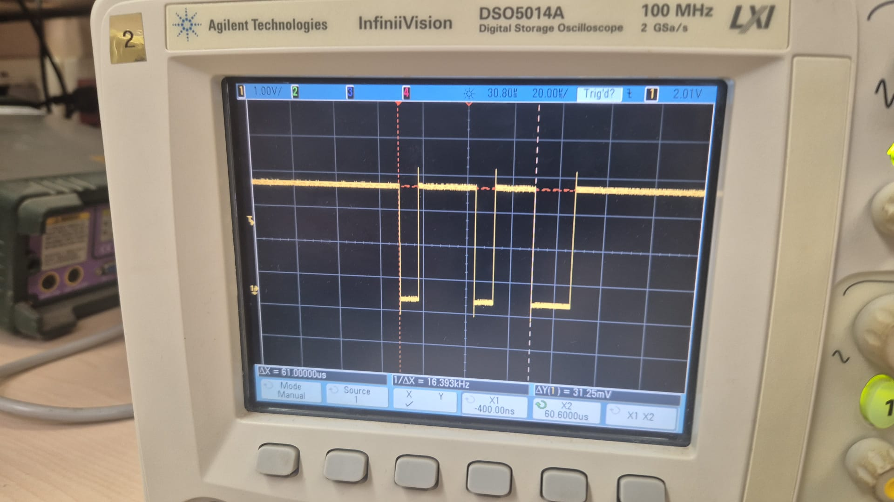
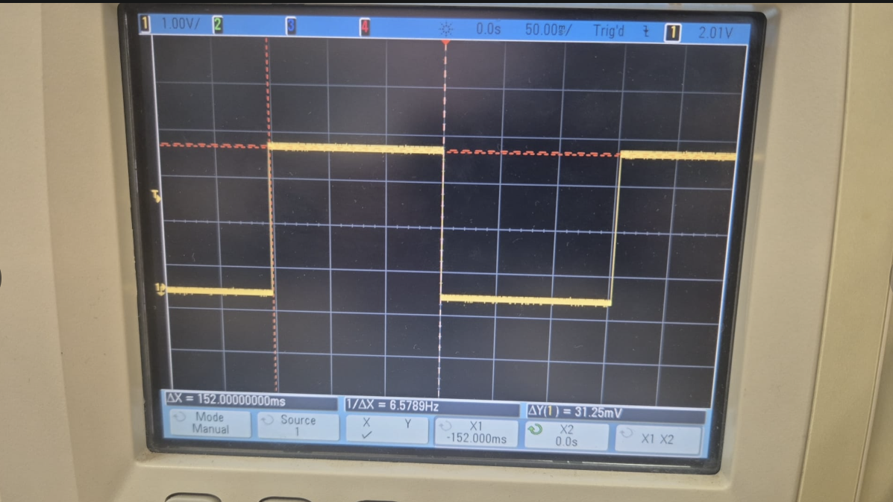

# Lab 2: Measurements and Checks

Ron Ladin 213465974 · Dan Chetirkin 323126854
NUCLEO-G491RE, 170 MHz, 115200 baud 8N1 (COM7 on 2026-11-12; the board is COM8 now, and the scripts find the port automatically). Board checks run on 2026-11-12 with this project's code (Debug build, `-O0`).

- **Items to keep (Table 2):** in `submission/`: the six `main.c` copies and the two scope images.
- **Scope images:** `captures/A2/A2.jpeg` and `captures/A3/A3b.png` (Agilent DSO5014A).
- **Board check logs:** `captures/<task>/check-*.txt`, made by `verify_board.py`. Every check passed.
- **Register values:** read over ST-LINK in hot-plug mode, so the program keeps running and RDR is never read.
- **Debugger transcripts:** `captures/<task>/debug-*.txt`, made by `debug_session.py`. It uses the same debugger as VS Code (ST-LINK_gdbserver + arm-none-eabi-gdb). It pauses the program, evaluates the task's WATCH expressions, and uses breakpoints while the PC sends characters or Modbus requests. All 7 sessions ran on 2026-11-12.

## Status

| Task | Required image (Table 2) | Have it? | Board check | Debugger | Still to do |
|---|---|---|---|---|---|
| A1 | none | `A1/01-startup.jpg` | PASS: `A1/check-A1.txt` | `A1/debug-A1.txt` | Optional: Serial Monitor screenshot of 10 presses and a held press (the old one shows only 6 digits) |
| A2 | PC4 frame of one B1 press | **yes**: `A2/A2.jpeg` | PASS: `A2/check-A2.txt` | `A2/debug-A2.txt` | Confirm that the Serial Monitor showed **7**; cursor reading of start to stop edge (see the end of this file) |
| A3 | PA5 busy-wait delay | **yes**: `A3/A3b.png` | PASS: `A3/check-A3a/b/c.txt` | `A3/debug-A3b.txt`, `A3/debug-A3c.txt` | Nothing |
| B1 | none | `B1/01-modbus-write.png` | PASS: `B1/check-B1.txt` | `B1/debug-B1.txt` | Nothing |
| B2 | none | `B2/01..03-*.png` | PASS: `B2/check-B2.txt` | `B2/debug-B2.txt` | Nothing |
| B3 | none | `B3/01-crc-timing.png` | PASS: `B3/check-B3.txt` | `B3/debug-B3.txt` | Nothing |

---

## Predictions (pre-lab numbers used in the comparisons)

| Exercise | Value | Checked on the board |
|---|---|---|
| 1(a) CR1 | UE bit 0, RE bit 2, TE bit 3, RXNEIE bit 5 | A1: `CR1 = 0x0D` (UE, RE, TE). A3c: `CR1 = 0x2D` (+ RXNEIE) |
| 1(b) ISR | TXE bit 7, RXNE bit 5, ORE bit 3 | A3b: `ISR = 0x006000D8` |
| 1(c) clock | `RCC->APB1ENR2` bit 0, LPUART1EN | LPUART1 works |
| 2(a) LPUART1 BRR | 256 × 170 MHz / 115200 = 377 777.8 → **377 778**. This is ≥ 0x300, and fck/baud = 1475.7 is inside 3–4096 | `LPUART1->BRR = 377778` → 115 199.9 baud |
| 2(b) USART1 BRR | 170 MHz / 115200 = 1475.7 → **1476** (≥ 16) | `USART1->BRR = 1476` → 115 176 baud (−0.02 %) |
| 2(c) times | bit **8.681 µs**; frame of 10 bits **86.81 µs** | See A2 |
| 3(a)/(b) AF | PA2, PA3 = **AF12**; PC4 = **AF7** | A1: `AFR[0]` field `0xCC`. A2: PC4 field `7` |
| 4(a)/(b) IRQ | position **91**, `LPUART1_IRQHandler`; **ISER[2] bit 27** (91 = 2·32 + 27) | A3c: `NVIC->ISER[2] = 0x08000000` |
| 5(a) | byte 86.8 µs; 8-byte request **694.4 µs** | — |
| 5(b) | 3.5 characters of idle = **303.8 µs** | — |
| 5(c) | 15-byte reply **1302.1 µs** | — |
| 6(a) | `01 06 00 00 00 01 48 0A`: address 1, function 0x06 (write one register), register 0 (REG_LD2), value 1 | B1 sends this request |
| 6(b) | CRC = **0x0A48**, sent low byte first: `48 0A` | Computed with `crc16()` of `lab02_modbus.py` |
| 6(c) | Last byte 0x0B → CRC mismatch → **no reply**. `bad` increases; after 0.2 s the master sends the request again | B2 noise test |

---

## A1: Text and random digits

- **Startup:** `"Lab 2 ready.\r\n"` at reset (PASS).
- **Digits:** `captures/A1/01-startup.jpg` shows the startup line and the digits `602741`.

**WATCH values** (debugger, program paused at `lab2partAtask1.c:152` in the main loop; `debug-A1.txt`):

| Expression | Value | Meaning |
|---|---|---|
| `(GPIOA->MODER >> 4) & 0xF` | **10 = 0xA = 0b10 10** | PA3 = 10, PA2 = 10: alternate function mode |
| `(GPIOA->AFR[0] >> 8) & 0xFF` | **204 = 0xCC** | PA3 = AF12, PA2 = AF12: LPUART1_RX / LPUART1_TX |

**Extra values from the same pause:**
- Full registers: `GPIOA->MODER = 0xABFFF7AF`, `GPIOA->AFR[0] = 0x0000CC00`.
- `(GPIOA->MODER >> 26) & 3` = 2: PA13 is still SWDIO.
- `(GPIOA->MODER >> 10) & 3` = 1: PA5 (LD2) is an output.
- `(GPIOC->MODER >> 26) & 3` = 0: PC13 (B1) is an input.
- `RCC->APB1ENR2 & 1` = 1: the LPUART1 clock is on.
- `LPUART1->BRR` = 377778.
- `LPUART1->CR1` = 0xD: UE + RE + TE.
- `previous` = 0: B1 was not pressed.

**How this connects PA2/PA3 to LPUART1:** `uart_init()` writes `0xA << 4` into MODER and `0xCC << 8` into AFR[0]. Mode 10 hands each pin to a peripheral instead of ODR/IDR, and AF12 selects LPUART1 from the pin's alternate-function multiplexer. PA13/PA14 (SWD) keep their fields because the code masks only bits 7:4 and 15:8.

---

## A2: One UART frame on PC4



**Scope settings:** 1.00 V/div, 20.00 µs/div, trigger at 2.01 V.
**Cursors:** X1 = −0.400 µs (start-bit falling edge), X2 = 60.600 µs → **ΔX = 61.0 µs**.

X2 sits on the falling edge where data bit 6 starts. So ΔX covers the start bit plus data bits 0–5: **7 bit times**. The edge positions in the photo confirm the bit lengths: 1, 3, 1, 2, 2 bits.

### Decoding (bit 0 first)

```
          idle start d0 d1 d2 d3 d4 d5 d6 d7 stop idle
level:     1     0    1  1  1  0  1  1  0  0   1    1
```

d7…d0 = `0011 0111` = **0x37 = '7'**. Every digit 0x30–0x39 has d4 = d5 = 1 and d6 = d7 = 0, which matches the photo.

### Timing

| Quantity | Predicted | Measured | Difference |
|---|---|---|---|
| (a) one bit time | 8.681 µs | 61.0 µs / 7 = **8.714 µs** | +0.4 % |
| (b) start-bit fall → stop-bit rise (9 bits) | 9 × 8.681 = **78.12 µs** | ≈ 78–79 µs, read from the graticule (no cursor on this edge) | Within reading error |
| (c) baud rate | 115 176 (BRR 1476); 115 200 nominal | 1 / 8.714 µs = **114 754** | −0.4 % |

The 0.4 % difference is about 0.2 µs per bit, which is inside the uncertainty of placing the cursors at 20 µs/div. Measuring over 7 bits instead of 1 divides that error by 7.

**Levels:** about 0 V low and about 3.3 V high; idle and stop bit are high.

**Board check:** PC4 mode 10, AF7; `USART1->BRR = 1476`; `USART1->CR1 = 0x09` (UE and TE; RE = 0, transmit only); the startup line is identical to A1 (PASS).

**Debugger** (paused at `lab2partAtask2.c:168`; `debug-A2.txt`):

| Expression | Value | Meaning |
|---|---|---|
| `(GPIOC->MODER >> 8) & 3` | 2 | PC4 in mode 10, alternate function |
| `(GPIOC->AFR[0] >> 16) & 0xF` | 7 | AF7 = USART1_TX |
| `(RCC->APB2ENR >> 14) & 1` | 1 | USART1 clock on |
| `USART1->BRR` | 1476 | 170 MHz / 1476 = 115 176.2 baud |
| `LPUART1->BRR` | 377778 | 256 × 170 MHz / 377778 = 115 199.9 baud |
| `USART1->CR1` | 0x9 | UE + TE; RE = 0 |

---

## A3: Reception during a busy-wait delay

### (b) Measured delay on PA5



**Scope settings:** 1.00 V/div, 50.00 ms/div, trigger at 2.01 V.
**Cursors:** X1 = −152.000 ms (rising edge), X2 = 0.0 s (next falling edge) → **ΔX = 152.0 ms** (1/ΔX = 6.58 Hz). The following low interval also spans about 3 divisions, about 150 ms.

| Quantity | Value |
|---|---|
| One loop pass (time between successive edges) | **152 ms** |
| LD2 period (2 passes) | ≈ 304 ms, ≈ 3.3 Hz |
| Cycles per pass | 0.152 s × 170 MHz = 25.8 M → **≈ 12.9 cycles per iteration** of the `-O0` volatile loop (2 000 000 iterations) |
| One frame | 86.8 µs → 10 characters take **0.87 ms**, 0.6 % of one pass |
| Characters that could arrive during one pass | 152 ms / 86.8 µs ≈ **1750** |

### Results (this project's code)

| Stage | Sent | Returned | Registers |
|---|---|---|---|
| A3a: polling, no delay | `0123456789` | `0123456789` **(10/10)** | — |
| A3b: polling + delay, first burst | `0123456789` | `0` **(1/10)** | — |
| A3b: polling + delay, second burst | `0123456789` | nothing **(0/10)** | `ISR = 0x006000D8` → **RXNE = 0, ORE = 1** |
| A3c: interrupt + delay, two bursts | `0123456789` × 2 | `0123456789` **(10/10)** both times | `CR1 = 0x2D` (RXNEIE = 1), `ISER[2]` bit 27 = 1, ORE = 0 |

**A3b WATCH values:**
- `(LPUART1->ISR >> 5) & 1U` = **0** (RXNE)
- `(LPUART1->ISR >> 3) & 1U` = **1** (ORE)

`0x006000D8` decodes as REACK, TEACK, TXE, TC, IDLE and ORE set; RXNE clear.

### A3b in the debugger (`debug-A3b.txt`)

| Step | Where the program is | RXNE `(LPUART1->ISR >> 5) & 1U` | ORE `(LPUART1->ISR >> 3) & 1U` | ISR |
|---|---|---|---|---|
| 1. Pause right after reset | In the delay loop, `lab2partAtask3.c:218`, **i = 574 439** of 2 000 000 | 0 | 0 | — |
| 2. PC sends line 1; breakpoint on the echo line 212 hits after the delay | `uart_putc((char)LPUART1->RDR);` | **1** | **1** | `0x006000F8` |
| 3. Step over the echo line (it reads RDR, sends `'0'`) | line 217 | **0** | **1** | — |
| 4. PC sends line 2; pause 7 loop passes later (**the task's WATCH demo**) | line 217 | **0** | **1** | `0x006000D8` |

- **Step 1:** the random pause landed inside the busy-wait loop, because that is where the CPU spends almost all of its time.
- **Step 2:** when the loop finally checks, RXNE = 1 (`'0'` waits in RDR) and ORE = 1 (`'1'`–`'9'` already overran).
- **Step 3:** reading RDR cleared RXNE, but nothing clears ORE.
- **Step 4:** line 2 never reaches RDR. Echo seen on the PC: `'0'` after line 1, nothing after line 2.

### Explaining the lost characters (A3b)

All 10 characters arrive in 0.87 ms. That is much shorter than one 152 ms pass, so they all arrive while the CPU is inside the delay and checks nothing.

1. `'0'` moves into RDR and sets RXNE = 1.
2. `'1'` finishes while RXNE is still 1, so there is nowhere to put it. That is an **overrun**: ORE = 1, and `'1'`…`'9'` are lost. RDR keeps `'0'`.
3. After the delay, the loop sees RXNE = 1, reads RDR, and echoes `'0'`. The read clears RXNE.
4. The polling code never clears ORE (ICR.ORECF). While ORE = 1, received data no longer reaches RDR, so the **second burst returns nothing**. WATCH then shows RXNE = 0 and ORE = 1.

### Why the interrupt version keeps everything (A3c)

- Each character sets RXNE, and RXNEIE + NVIC turn that into an interrupt.
- The CPU leaves the delay loop, and `LPUART1_IRQHandler` reads RDR (clearing RXNE) and echoes the character. That takes a few µs, much less than the 86.8 µs until the next character is complete.
- RDR is therefore always empty again before the next byte arrives, so there is no overrun. The delay simply continues after the handler returns.
- The handler also clears ORE, so reception could recover even if an overrun did happen.

### A3c in the debugger (`debug-A3c.txt`)

**Before the test:**
- `(LPUART1->CR1 >> 5) & 1U` = **1**: RXNEIE is set.
- `(NVIC->ISER[2] >> 27) & 1U` = **1**: IRQ 91 is enabled.

**Breakpoint on `LPUART1_IRQHandler`; the PC sends one character `'A'`. The breakpoint hits:**
- `IPSR = 107 = 16 + 91`: the CPU is running the LPUART1 interrupt.
- RXNE = **1**, ORE = **0**: the character is waiting in RDR, and nothing was lost.
- The call stack (`bt full`) shows the interrupt stopped the delay in the middle:

  ```
  #0  LPUART1_IRQHandler () at lab2partAtask3.c:145
  #1  <signal handler called>
  #2  main () at lab2partAtask3.c:218          i = 1545729
  ```

  The interrupt stopped `main()` inside the busy-wait loop, with i = 1 545 729 of 2 000 000.

**After stepping over the handler's echo line 150:**
- RXNE = **0**: RDR was read a few µs after the byte arrived.
- The PC received `'A'`.
- When the handler returns, the delay continues from i = 1 545 729.

---

## B1: Writing LD2 through Modbus

`lab02_modbus.py --write-only`: **20/20 writes OK on the first send**; LD2 toggles. Summary: 20 sends, 0 with a wrong bit, 0 with no reply, 0 invalid replies.
Evidence: `captures/B1/01-modbus-write.png` and `check-B1.txt`.

### B1 in the debugger: answering "Explain reception" (`debug-B1.txt`)

**At the start:** the program is paused in the loop (`lab2partBtask1.c:181`). `message_len = 0` (the buffer is free), and `regs = {0, 0, 0, 0, 0}`.

**1) The PC sends `01 06 00 00 00 01 48 0A` (write LD2 = 1). The breakpoint in `HAL_UARTEx_RxEventCallback` hits.**

The call stack shows the callback runs inside the interrupt, while `main()` waits in its loop:

```
#0 HAL_UARTEx_RxEventCallback (size=8)
#1 HAL_UART_IRQHandler        (stm32g4xx_hal_uart.c)
#2 LPUART1_IRQHandler         (partB_support.c)
#3 <signal handler called>
#4 main () at lab2partBtask1.c:181
```

`size = 8`, `rx = 01 06 00 00 00 01 48 0A`, and `message_len = 0`, so the callback copies `rx` into `message`.

**2) The breakpoint in `handle_message` hits, called from `main()` line 182.**
- `message_length = 8` and `message = 01 06 00 00 00 01 48 0A`: address 1, function 0x06, register 0, value 1.
- `message_len = 8`: **the buffer is occupied** while the loop works. A message that completes now would be thrown away by the callback, because `message_len != 0`.

**3) Error recovery.**
1. With the CPU still paused, the PC sends another request. Nobody reads RDR, so `(LPUART1->ISR >> 3) & 1U` becomes **1** (overrun).
2. On `continue`, the breakpoint in `HAL_UART_ErrorCallback` hits, interrupting `handle_message`:
   - `huart->ErrorCode = 0x8` (HAL_UART_ERROR_ORE).
   - `huart->RxState = 0x20` (READY): the HAL stopped reception.
3. After our call `HAL_UARTEx_ReceiveToIdle_IT(...)`, `huart->RxState = 0x22` (BUSY_RX): **reception runs again**.

**4) Back in the loop.**
- `regs = {LD2 1, good 1, bad 0, 0, 0}`, the LD2 pin `(GPIOA->ODR >> 5) & 1U` = 1, and `message_len = 0` (cleared after `handle_message` returned).
- The PC received the reply `01 06 00 00 00 01 48 0A`, a copy of the request.

**5) The PC sends a write of LD2 = 0.** It is received normally, and the reply is `01 06 00 00 00 00 89 CA`.
- LD2 turns off.
- `regs = {0, good 2, bad 0, 0, 0}`: the request lost to the overrun was never received.
- In normal use, the master's 0.2 s retry would send it again.

---

## B2: Reads, exceptions, noise

| Test | Result |
|---|---|
| Normal run (20 rounds) | 40/40 requests OK on the first send; each read returns the LD2 value just written; `good` rises 2 per round (2 → 40); `bad = 0` |
| `--exceptions`: read register 9 | **exception code 02** (illegal data address). Predicted 02: register 9 is not in the map 0–4 |
| `--exceptions`: function 0x04 | **exception code 01** (illegal function). Predicted 01: only 0x03 and 0x06 are supported |
| `--errors 0.3`, earlier run (screenshot `03-crc-noise.png`) | 62 sends, **22 with a wrong bit**; last read **bad = 22**; all 40 requests completed |
| `--errors 0.3`, run of 2026-11-12 14:49 (`check-B2.txt`) | 55 sends, **15 with a wrong bit**; last read **bad = 15**; all 40 requests completed |

### B2 in the debugger (`debug-B2.txt`)

Each row is one request the PC sent; the program starts with `regs = {0, 0, 0, 0, 0}`.

| PC sends | What the debugger shows | Board reply | `regs` after (good, bad) |
|---|---|---|---|
| `01 03 00 09 00 01 54 08`: read register 9 | Breakpoint `exception(function = 0x03, code = 2)`, called from `handle_message` ← `main` | `01 83 02 C0 F1` | 1, 0 |
| `01 04 00 00 00 01 31 CA`: function 0x04 | `exception(function = 0x04, code = 1)` | `01 84 01 82 C0` | 2, 0 |
| `03 03 00 00 00 05 85 C9`: read with address bit 1 flipped | `message = 03 03 …`; CRC mismatch → `bad++`, no reply | none | 2, **1** |
| `02 03 00 00 00 05 85 FA`: correct read for slave 2 | CRC OK, address ≠ 1 → ignored | none | 2, 1 (no change) |
| `01 03 00 00 00 05 85 C9`: read registers 0–4 | `good++` → reply | `01 03 0A 00 00 00 03 00 01 00 00 00 00 2A 76` | **3**, 1 |

The last reply decodes as: 10 data bytes; LD2 = 0, good = 3, bad = 1, crc_sw = 0, crc_hw = 0; CRC `2A 76`.

The third row is the proof for question (f). The flipped bit made the address look like slave 3. Because the CRC is checked first, the board counted it in `bad` instead of ignoring it as another slave's message.

- **(b) Prediction for `bad`:** `bad` = the number of sends with a flipped bit. A CRC-16 detects every single-bit error, and the board counts a CRC mismatch whatever the address byte says. Both runs match exactly.
  - A difference could appear only if a corrupted send happened after the last successful read, because `bad` is sampled when the board handles the read.
- **(f) Why `good` rises by 2 per round:** each round sends one write and one read to slave 1, both with a matching CRC. The read is counted before its reply is built, so it is included in the value it returns.
- **(f) Why the CRC is checked before the address:** the CRC also covers the address byte. A bit error in the address could make a message for this board look like one for another slave. Checking the address first would silently drop it and never count it in `bad`. Only after the CRC matches can the address be trusted.

**(g) Time budget for one read exchange:**

| Item | Time |
|---|---|
| Request (8 bytes) | 694.4 µs |
| Idle after it (3.5 characters) | 303.8 µs |
| Reply (15 bytes) | 1302.1 µs |
| Idle after it (3.5 characters) | 303.8 µs |
| **Total** | **2.60 ms**, against the master's **200 ms** limit (77×) |

The time limit is much larger because the PC side adds latency the line time doesn't include: USB transfers through the ST-LINK virtual COM port, Windows driver buffering and scheduling, and Python. Retrying too early would also send duplicates.

---

## B3: Software CRC vs the CRC unit

**CRC input:** an 8-byte request minus 2 CRC bytes = **6 bytes**.

**Prediction:**
- **Software:** about 8 cycles per bit step × 48 steps, plus per-byte overhead → **≈ 424 cycles**.
- **Hardware:** the CRC unit needs 1 AHB cycle per byte (6 cycles), plus the reset write, 6 byte writes to DR, the result read, and the loop instructions → **≈ 54 cycles**.
- **Expected ratio ≈ 7.9; the CRC unit should be faster.**
- **Assumptions:** about 1 cycle per simple instruction, 2–3 cycles per peripheral access. Table 9's 1 cycle/byte excludes reset, writes and the result read.

**Measurement** (cycle counter, every round identical):

| Run | crc_sw | crc_hw | Software time | Hardware time | Ratio |
|---|---|---|---|---|---|
| This project, 2026-11-12 14:49 (`check-B3.txt`) | **1527** cycles | **219** cycles | **8.98 µs** | **1.288 µs** | **6.97** |
| Earlier screenshot (`01-crc-timing.png`) | 1521 (one round 1593) | 218 | 8.95 µs | 1.282 µs | 6.98 |

The 1593 in the earlier run is a one-off, most likely an interrupt during that single measurement.

**Per byte** (6 input bytes):

| | Cycles per byte | Time per byte | Compared with the line (86.8 µs per byte) |
|---|---|---|---|
| Software | 254.5 | **1.50 µs** | 58× faster than the line |
| Hardware | 36.5 | **0.215 µs** | 404× faster than the line |

### B3 in the debugger (`debug-B3.txt`)

**After the preparation, with the program paused:**

| Expression | Value | Meaning |
|---|---|---|
| `(CoreDebug->DEMCR >> 24) & 1U` | 1 | TRCENA |
| `DWT->CTRL & 1U` | 1 | CYCCNTENA: `DWT->CYCCNT` counts every cycle |
| `(RCC->AHB1ENR >> 12) & 1U` | 1 | CRCEN |
| `CRC->POL` | 0x8005 | The polynomial |
| `CRC->INIT` | 0xFFFF | The start value |
| `CRC->CR` | 0xA8 | POLYSIZE = 01 (16 bits), REV_IN = 01 (by byte), REV_OUT = 1 |

**Breakpoint at the end of `crc_ok()` (line 142), while the PC reads registers 0–4 with `01 03 00 00 00 05 85 C9`:**
- `received = crc_sw = crc_hw = 0xC985`: both calculations agree with the received CRC (`85 C9`, low byte first).
- `byte_count = 6`.
- `regs[3] = 1527` and `regs[4] = 219` → 8.98 µs and 1.288 µs, ratio 6.97.

The board's reply `01 03 0A 00 00 00 01 00 00 05 F7 00 DB C5 13` carries the same values: crc_sw = 0x05F7 = 1527 and crc_hw = 0x00DB = 219.

**Comparison:** the ratio (≈ 7.0) is close to the predicted 7.9, and hardware is faster as expected. Both absolute counts are about 3.6× above the prediction because the Debug build (`-O0`) keeps every variable on the stack: each step is a load and a store. There are also 4 flash wait states at 170 MHz. Both calculations still finish far faster than one byte takes on the line.

---

## Still to do (needs you at the bench)

1. **A2: confirm the digit.** The photo decodes to **`'7'`**, but no Serial Monitor screenshot from that moment was saved; `01-serial-a2.png` shows an older run (`4644`).
   Best: retake A2 once (about 2 minutes):
   1. Run `.\run-task.ps1 A2`, open the Serial Monitor, and set the scope to Single mode.
   2. Press B1 once.
   3. Put **X1 on the start-bit falling edge** and **X2 on the stop-bit rising edge**. ΔX should read **≈ 78 µs**.
   4. Photograph the scope and screenshot the Serial Monitor showing the same digit.

   This also gives a cursor value for measurement (b).
2. **A1 (optional):** a Serial Monitor screenshot with 10 presses giving 10 digits, then one long press giving 1 digit.
3. **WATCH live at the test:** all WATCH values are recorded in the debugger transcripts. The instructor will probably still want to see them in VS Code:
   - **A1:** start Debug A1, press F5, then F6, and add the two GPIOA expressions.
   - **A3b:** start Debug A3b, press F5, send two lines, press F6, and add the RXNE and ORE expressions.

   A WATCH screenshot of each is optional extra evidence.

### Re-running the board checks

Close the Serial Monitor, and also kill its `COMx (Microsoft)` terminal tab. Then:

```powershell
cd "C:\Users\danch\OneDrive\Desktop\Homeworks\lab\lab2"
python verify_board.py            # all tasks, about 1 minute; leaves B3 running
python verify_board.py A3b A3c    # only some tasks
python debug_session.py           # the debugger sessions, about 1 minute
python debug_session.py A3c B1    # only some
```
